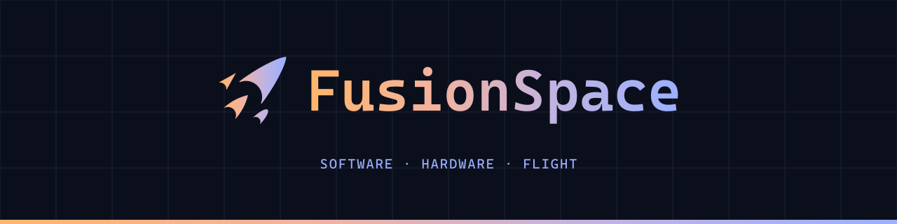

<!-- GitHub profile README for FusionSpace. Create a repo named exactly like your username, add this as README.md,
     and copy readme-banner-dark.png / readme-banner-light.png into it (paths below assume the repo root). -->
<pictur se>
  <source media="(prefers-color-scheme: dark)" srcset="readme-banner-dark.png">
  <source media="(prefers-color-scheme: light)" srcset="readme-banner-light.png">
  
</picture>

### Hi, I'm Neer.

Software engineer. [FusionSpace](https://fusionspace.co) is where my own projects live: software and embedded systems, games, electronics, mechanical and machined parts, and aerospace. Each project is named after a star.

| Project | What | Status |
|---|---|---|

Discipline tags

| Tag | Meaning |
|---|---|
| `SW` | Software |
| `EMB` | Embedded and flight software |
| `ELEC` | Electronics and PCBs |
| `MECH` | Mechanical design |
| `MFG` | Machining and fabrication |
| `AERO` | Aerospace |
| `GAME` | Games |

